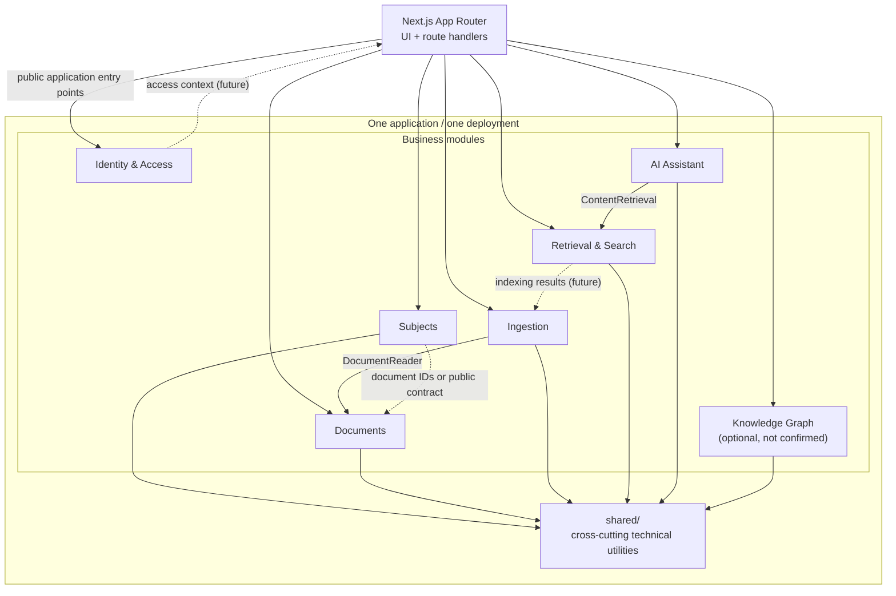

# Module boundaries

Status: initial foundation. No application features are implemented. This
document defines the intended boundaries for the modular monolith and is
expected to evolve with explicit architecture decisions.

## 1. Module responsibility matrix

| Module | Owns | Approved cross-module imports (enforced) | Must not own or depend on |
| --- | --- | --- | --- |
| **Identity & Access** (`identity-access`) | User identity, roles, authentication capabilities, authorization policies, access context | None; it is a provider to other modules | Subject, document, ingestion, search, or AI business workflows; other modules' persistence |
| **Subjects** (`subjects`) | Academic subject catalog, academic reference metadata, subject–reference associations | None | Uploaded files, text extraction, document storage, retrieval internals |
| **Documents** (`documents`) | Document metadata, ownership, visibility, file lifecycle, storage coordination | None | Extraction, chunking, embeddings, indexing, retrieval, AI answer generation |
| **Ingestion** (`ingestion`) | Processing workflow: extraction, normalization, processing status, failures, retries | `documents` — `DocumentReader` / `DocumentSnapshot` | Document ownership, visibility, or lifecycle changes; search/relevance; AI workflows |
| **Knowledge Graph** (`knowledge-graph`) | Concepts, relationships, evidence linking concepts to sources (if adopted) | None | Source files, extraction, general retrieval, authentication, AI answers |
| **Retrieval & Search** (`retrieval-search`) | Search/retrieval contracts, eligibility-aware retrieval, source provenance | None | Document ownership/visibility, extraction, answer generation, authorization policy definitions |
| **AI Assistant** (`ai-assistant`) | Question-answering orchestration, optional conversation behaviour, LLM ports, citation coordination | `retrieval-search` — `ContentRetrieval` | Direct access to other modules' persistence, search implementation, document or ingestion internals |

`shared/` is not a business module. It contains only cross-cutting technical
utilities and must not import any module.

The enforced allowlist is exactly the two edges in the table. Interactions
described in [section 5](#5-proposed-interactions) are proposals and are not
permission to import another module. Approving an edge requires updating this
table and the architecture checker in the same change.

## 2. Allowed dependency rules

1. A module may import another module only through that module's `index.ts`
   public entry point.
2. Cross-module imports must use the public contract or application entry point
   explicitly exported by the target module.
3. A module may freely use its own internal paths (`domain/`, `application/`,
   `infrastructure/`) because they are private to that module.
4. Domain code may depend only on domain code and framework-free shared types.
   It must not import Next.js, React, the database layer, AI SDKs, or
   infrastructure implementations.
5. Application use cases depend on interfaces/ports, not concrete
   infrastructure classes.
6. Infrastructure adapters may implement application-level contracts and may
   depend on their module's application/domain code.
7. Next.js route handlers and UI components call module application entry
   points. They must not import repositories, ORM entities, storage adapters,
   search clients, or LLM adapters directly.
8. Modules may depend on `shared/` for genuinely cross-cutting technical
   utilities. `shared/` must never depend on modules.
9. The module dependency graph must remain acyclic. A new cross-module edge needs
   a concrete responsibility relationship, not just convenience.
10. Cross-module transactions should be expressed through explicit application
    workflows rather than by one module writing another module's tables.
11. The approved cross-module dependency allowlist is exactly
    `ingestion` → `documents` and `ai-assistant` → `retrieval-search`. A public
    API does not make an edge allowed; every other edge is rejected until it is
    explicitly approved, documented, and added to the architecture checker.

### Current concrete edges

- `ingestion` → `documents` via `DocumentReader` / `DocumentSnapshot`.
- `ai-assistant` → `retrieval-search` via `ContentRetrieval` (contract exists;
  no consuming use case yet).

These two edges are the complete checker allowlist. All other interactions are
proposed and must not be implemented until a real requirement appears and the
edge is approved.

## 3. Forbidden dependencies

- Deep imports such as
  `@/modules/documents/application/contracts/document-reader` from another
  module. Import `@/modules/documents` instead.
- Importing another module's `domain/`, `application/`, or `infrastructure/`
  path directly.
- `domain/` importing `next`, `react`, database clients, AI SDKs, or
  infrastructure adapters.
- `application/` importing its own concrete infrastructure implementation.
- `shared/` importing anything from `src/modules/*`.
- Modules importing `src/app/*` or other Next.js presentation code, whether by
  alias or relative path.
- One module reading or writing another module's tables or private persistence
  entities.
- Importing or re-exporting a module's own `infrastructure/` from its
  `index.ts`, directly or through a barrel file.
- Exposing repository classes, ORM models, storage keys with adapters, search
  clients, or LLM SDK types from a module `index.ts`.
- Using `shared/` as a home for business rules.
- Circular module dependencies.
- UI components or route handlers implementing business rules directly.
- Adding a dependency between modules solely to make an architecture diagram
  look complete.

## 4. Public APIs versus private implementation

A module's public API is exactly what its `index.ts` re-exports, plus the
behaviour documented in its `README.md`.

- **Public:** cross-module contract types, application entry points (use cases
  or queries), and stable error/result shapes intended for consumers.
- **Private:** everything under `domain/`, `application/`, and
  `infrastructure/` that is not re-exported. A file is not public merely
  because it is under `application/contracts`; it becomes public only through
  `index.ts`.
- **Never public:** persistence adapters, ORM entities, storage implementations,
  security adapters, search clients, LLM clients, and infrastructure wiring.
- Composition/wiring belongs outside the module's public API. Route handlers
  should receive or construct application entry points without reaching into
  adapters.

The current examples are deliberately small:

- `documents/index.ts` exports only `DocumentReader`, `DocumentSnapshot`, and
  `DocumentVisibility`.
- `ingestion/index.ts` exports one application use case and its input type.
- `retrieval-search/index.ts` exports only retrieval contract types.
- `identity-access`, `subjects`, `knowledge-graph`, and `ai-assistant` currently
  export nothing because no public contract is justified yet.

## 5. Proposed interactions

These are boundaries, not a requirement to implement all integrations now. The
only approved cross-module imports are the two listed in section 1; every
interaction below is a proposal and is rejected by `npm run arch:check` until
the allowlist and this document are deliberately updated.

- **Identity & Access → protected flows:** provides identity and authorization
  context. Other modules consume the context; they do not read identity tables.
- **Subjects → Documents:** Subjects may reference documents through stable
  identifiers or the Documents public contract, never document storage
  internals.
- **Documents → Ingestion:** Documents exposes the metadata Ingestion needs
  through `DocumentReader`. Ingestion must not change ownership or visibility.
- **Ingestion → downstream indexing:** Ingestion is expected to publish or
  expose processing results for downstream indexing. No indexing contract or
  implementation exists yet.
- **Retrieval & Search → eligible content:** Retrieval consumes indexing output
  and returns source metadata suitable for citations. It must respect document
  access restrictions.
- **AI Assistant → Retrieval & Search:** AI Assistant calls retrieval through
  the explicit `ContentRetrieval` application-facing contract.
- **Knowledge Graph → extracted content (optional):** Knowledge Graph may
  consume extracted content and expose graph-related retrieval capabilities if
  the feature is adopted. It is not a confirmed MVP requirement.

## 6. Logical dependency diagram

The diagram represents **logical module dependencies inside one modular
monolith**, not separate deployable services, packages, or databases. Solid
arrows between modules are the two approved dependencies. Dashed arrows are
proposals that are not approved for import. Arrows do not imply that a feature
is implemented. The Knowledge Graph is included for structural completeness
only and is not confirmed for the MVP.

Identity & Access is shown as a provider to protected flows rather than drawing
an arrow to every module. Its concrete contract is not implemented yet.

## 7. Enforcement and review

- `npm run arch:check` runs `tests/architecture/check-module-boundaries.mjs`.
  It resolves alias and relative imports, checks public-entry-point and deep
  imports, rejects non-allowlisted cross-module edges, rejects app-layer imports
  from modules/shared code, rejects infrastructure exposure through `index.ts`,
  applies the layer rules, and detects cycles in the module graph.
- `npm run arch:test` runs fixture-based tests for the checker itself.
- The check is TypeScript-only and uses regular expressions rather than a full
  TypeScript program analysis. JavaScript/CommonJS is not scanned; `allowJs` is
  disabled in `tsconfig.json` to keep that scope explicit.
- Code review must still reject accidental coupling and indirect re-exports that
  the lightweight scanner cannot see.
- Any new cross-module dependency must update this document, the relevant module
  `README.md`, the checker allowlist, and its fixture tests in the same change.

## 8. Unresolved decisions

The boundaries are provisional. Open questions include:

- Authentication provider, session model, and role/policy model.
- Whether conversation history is its own module.
- Database schema ownership, migration ownership, and cross-module transaction
  strategy.
- Search technology and where the index lifecycle lives.
- Whether Knowledge Graph is in the MVP and whether it needs graph storage.
- Background processing mechanism for Ingestion.
- Institution/tenant boundaries and document publication workflow.
